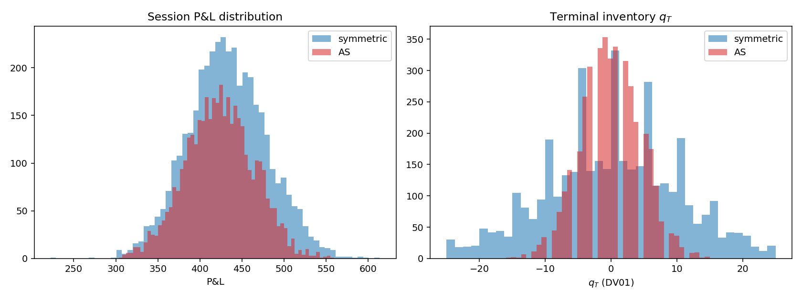
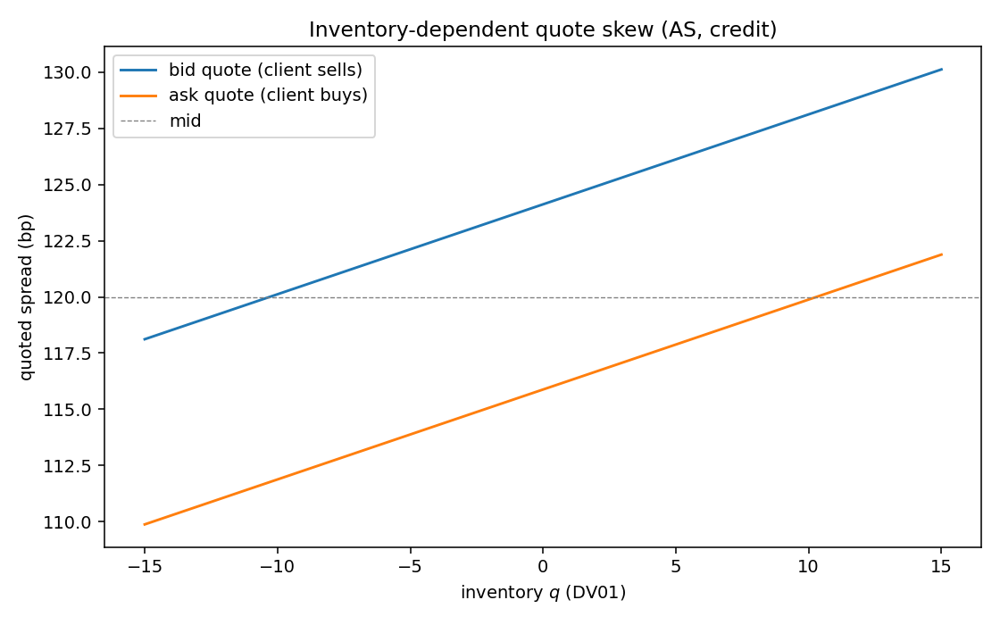
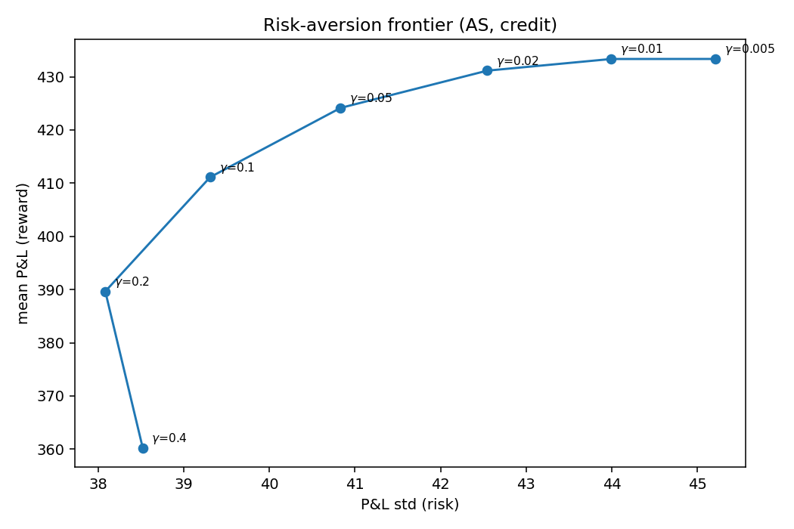
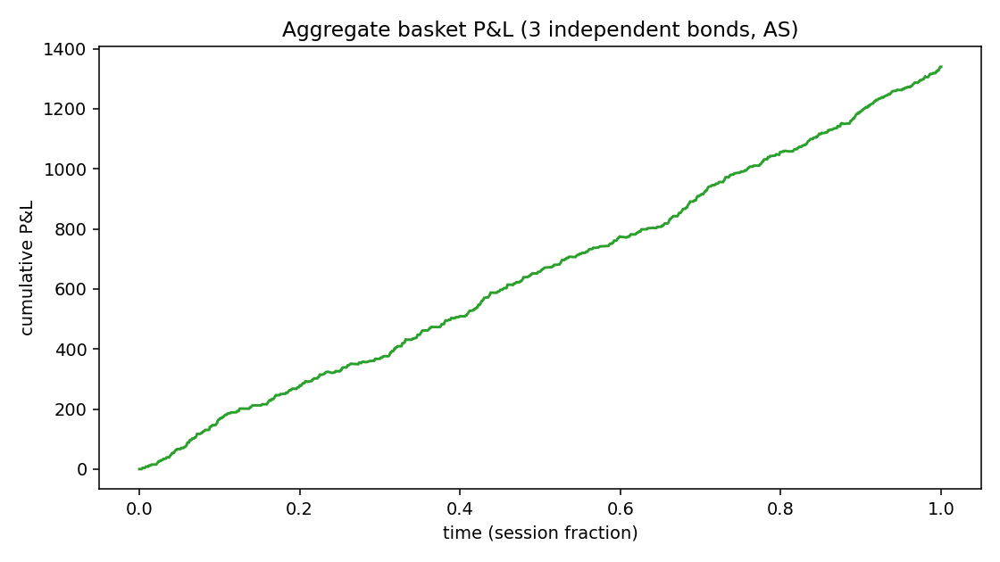

# Avellaneda–Stoikov Optimal Quoting, Adapted to Credit

An implementation of the canonical **Avellaneda–Stoikov (2008)** market-making
model, recast from price space into **credit-spread space** and studied by
Monte Carlo simulation over synthetic spread paths and a reduced-form Poisson
order flow.

> **This is a study of optimal quoting *behaviour*, not a backtest on historical
> flow.** All data are synthetic by construction. See `paper/paper.pdf` §3 and §6.

## What makes this a credit model (not the textbook exercise)

The original AS model is written in *price* space for an asset whose mid follows
arithmetic Brownian motion. Credit needs three changes, all implemented here:

1. **Spread is the state variable.** The risk driver is the mid credit spread
   `s_t` (bp), modelled as a mean-reverting, positivity-floored diffusion (OU;
   set `kappa=0` for the AS Brownian baseline).
2. **DV01-scaled risk.** Dealer P&L is a *price* quantity. Price is locally
   linear in spread through DV01, so the volatility entering the control problem
   is the *price* vol `DV01 * sigma`, and inventory risk scales with DV01.
3. **Sign-corrected skew.** Price moves *inversely* to spread, so a long-credit
   dealer shades the reservation spread **up** (not down), widening the bid and
   tightening the ask to shed risk. Getting this sign wrong makes the policy
   *accumulate* risk — see `paper/paper.pdf`, Remark 1 (we hit this bug and the
   regression test `test_as_controls_inventory_better_than_symmetric` guards it).

## Key results (baseline IG calibration, 4,000 sessions)

| | AS | Symmetric |
|---|---:|---:|
| mean P&L | 423.8 | 432.5 |
| P&L std | **40.6** | 47.0 |
| risk-adjusted ratio | **10.45** | 9.20 |
| std of terminal inventory | **4.54** | 9.89 |

The inventory-aware policy gives up a little expected edge for a large reduction
in inventory and P&L risk — the signature AS trade-off.



The inventory-aware policy keeps inventory close to flat. The quote *skew* is
the mechanism: a dealer long credit shades quotes to attract risk-reducing
trades.



Sweeping the risk-aversion `gamma` traces an efficient frontier of mean P&L
against P&L volatility — more risk aversion buys lower variance at the cost of
expected edge.



A small basket of independent bonds aggregates the per-name P&L:



## Layout

```
ascredit/
  model.py        # reservation spread, optimal quotes, skew (closed form)
  simulator.py    # synthetic spread paths (OU/BM) + Poisson fill model
  engine.py       # session simulation, P&L accounting, Monte Carlo
  experiments.py  # reproduces all paper figures/tables
tests/            # pytest suite (model sanity, skew sign, AS vs symmetric)
paper/            # rigorous LaTeX write-up (paper.tex -> paper.pdf)
figures/          # generated plots
results/          # JSON summaries
```

## Quickstart

```bash
pip install -r requirements.txt
pytest -q                      # run the test suite
python -m ascredit.experiments      # regenerate all figures + results
```

Minimal API:

```python
from ascredit.model import ASParams, optimal_quotes
from ascredit.simulator import SpreadModel, calibrate_k_from_halflife
from ascredit.engine import SimConfig, monte_carlo

p = ASParams(gamma=0.05, sigma=4.0, k=calibrate_k_from_halflife(3.0), A=140.0, dv01=1.0)
bid, ask = optimal_quotes(s=120.0, q=5.0, t=0.5, p=p)   # quotes in bp, long-credit skew

sm = SpreadModel(s0=120.0, sigma=4.0, kappa=1.0, theta=120.0)
res = monte_carlo(p, sm, SimConfig(strategy="as"), n_paths=2000)
print(res["mean_pnl"], res["std_terminal_q"])
```

## Building the paper

```bash
cd paper && pdflatex paper.tex && pdflatex paper.tex
```

## Limitations

Reduced-form Poisson flow (no adverse selection), independent bonds (no
portfolio inventory penalty / spread correlation), first-order DV01 P&L (no
convexity or jump-to-default), no costs/hedging/funding. These are the natural
extensions, discussed in §6 of the paper.

## Reference

Avellaneda, M. & Stoikov, S. (2008). *High-frequency trading in a limit order
book.* Quantitative Finance, 8(3), 217–224.

## License

MIT
