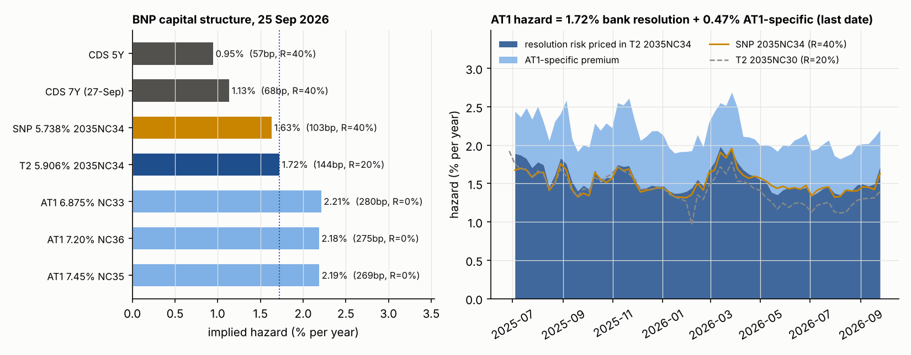
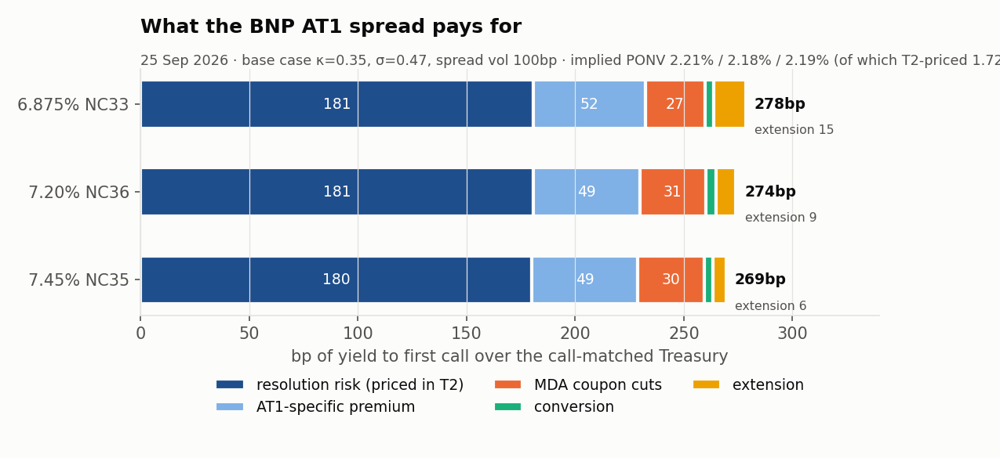
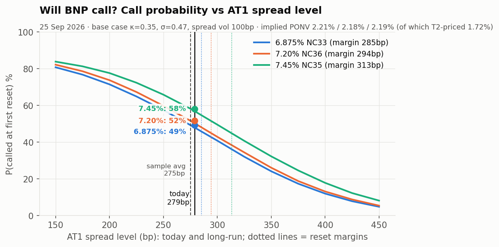
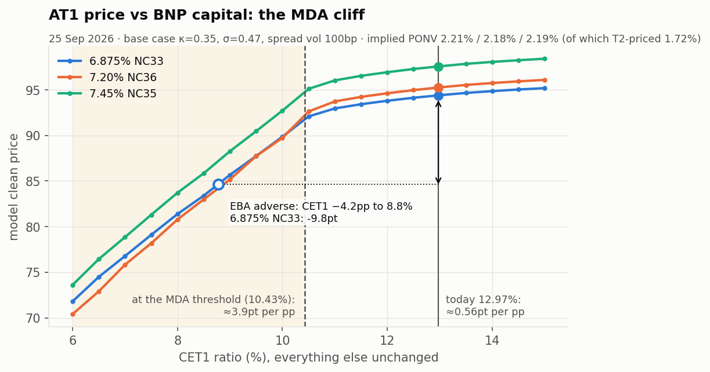
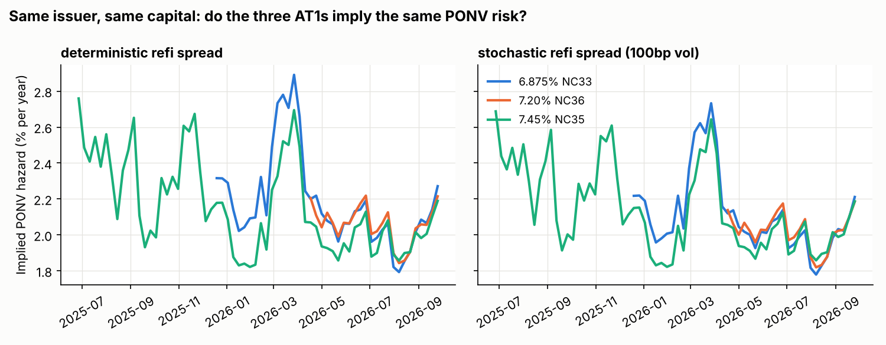
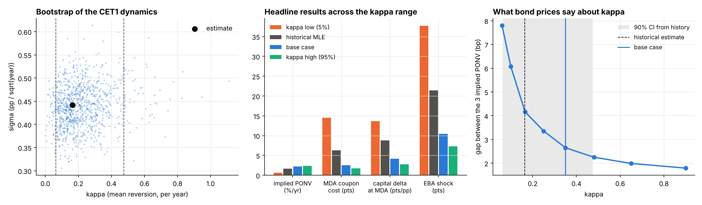
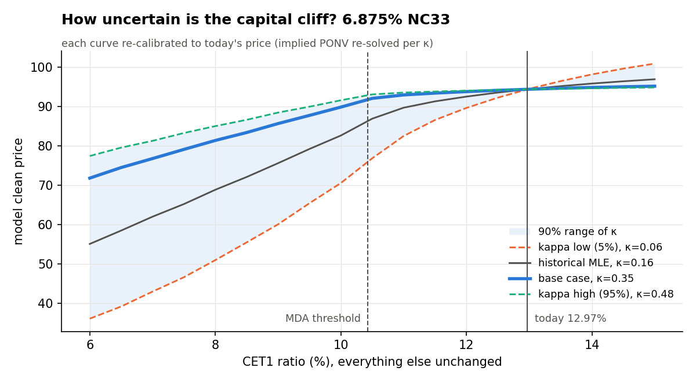

# BNP Paribas USD AT1s: what the spread pays for, will they be called, what can you lose

*Data to 25 September 2026. Model: this repository's CET1-driven Monte Carlo,
extended for real bonds in `src/at1_coco/market.py`. Academic project, not
investment advice.*

## The three bonds

Same issuer, same 5.125% group-CET1 trigger, same conversion into shares.
They differ only in coupon, first call and reset margin:

| | 6.875% NC33 | 7.20% NC36 | 7.45% NC35 |
|---|---|---|---|
| ISIN | US05602XQR25 | US05602XQS08 | US05602XQQ42 |
| First call = first reset | 15-Dec-2033 | 17-Apr-2036 | 27-Jun-2035 |
| Reset margin over 5y CMT | 285bp | 294bp | 313bp |
| Mid price, 25-Sep-2026 | 94.39 | 95.25 | 97.57 |
| Yield-to-call spread over the call-matched Treasury | 279bp | 274bp | 269bp |

## Key findings

1. **Most of the spread is BNP's own credit risk, already priced in its Tier 2.**
   Pricing BNP's Tier 2 (5.906% 2035NC34) and senior non-preferred bonds on the same
   simulated state splits the AT1 hazard (2.19%/yr) into **1.72% of bank resolution
   risk** (Tier 2 recovery 20%) and **0.47% AT1-specific premium**. In spread terms,
   of the ~270–280bp: **~180bp** resolution risk, **~50bp** AT1-specific premium,
   **27–31bp** expected MDA coupon cuts, **4bp** mechanical conversion and **6–15bp**
   extension. Tier 2 (R = 20%) and SNP (R = 40%) imply nearly the same hazard
   (1.72% vs 1.63%), so the Markit recovery conventions are consistent with the prices.
2. **The first call is a coin flip, and the 6.875% carries the most extension risk.**
   The model gives a **49% / 52% / 58%** probability of a call at the first reset.
   The 6.875%'s reset margin is only ~6bp above today's AT1 spread. If AT1 spreads
   settle 50bp wider, it loses **1.2pt more than if the call were certain**, against
   0.7pt for the 7.45%. The market behaved like this in the four weeks to 25 September
   2026: with the 10y Treasury up 45bp, the 6.875%'s spread widened a further
   +34bp, the other two only +10–12bp.
3. **Capital risk is a cliff, not a slope.** At today's 13% CET1 the price moves only
   **~0.6pt per point of CET1**; at the MDA threshold (10.43%, rising to 10.93% by
   2028 with the O-SII step-ups) the sensitivity is **~4pt per point**. The EBA adverse
   depletion (−4.2pp) costs **~10–11pt**, and **~25–27pt** if spreads also widen 200bp.
4. **The weakest input is how fast BNP rebuilds capital.** History alone puts the
   half-life of a capital shock anywhere between 1.5 and 11 years, and the stress
   results change by a factor of 5 across that range. Bond prices lean towards the
   faster end, but the differences are of the size of the bid–offer. The base case
   (κ = 0.35, half-life 2 years) is the value both sources can live with.
5. **One hazard prices all three AT1s, within the bid–offer.** The implied hazards
   (2.21% / 2.18% / 2.19%) are 2.6bp apart on the last date: 0.20–0.22 points of
   price, against a bid–offer of 0.15–0.29 points.

## 1. What BNP's Tier 2 says



Under EU resolution the creditor hierarchy holds: CET1 absorbs losses first, then
AT1, then Tier 2. BNP's Tier 2 bonds face the same resolution event as its AT1s,
without coupon discretion, MDA, trigger or perpetual extension. Priced on the same
simulated paths (bullet to the call, which the market treats as certain, recovery
paid at resolution), they show how much of the AT1 hazard is plain bank credit risk.

| 25-Sep-2026 | Spread (bp) | Recovery | Hazard (%/yr) | Share of AT1 hazard |
|---|---|---|---|---|
| Senior CDS 5Y (EUR) | 57 | 40% | 0.95 | 43% |
| Senior CDS 7Y (EUR, 27-Sep) | 68 | 40% | 1.13 | 52% |
| SNP 5.738% 2035NC34 | 103 | 40% | 1.63 | 74% |
| T2 2.588% 2035NC30 | 116 | 20% | 1.40 | 64% |
| **T2 5.906% 2035NC34 (anchor)** | **144** | **20%** | **1.72** | **78%** |
| AT1 (average of three) | 275 | 0% | 2.19 | 100% |

Over the 66 weekly dates the Tier 2 share of the AT1 hazard ranges from 66% to 80%
(mean 72%). It depends on the Tier 2 recovery: 63% at 0%, 78% at 20%, 90% at 30%. With
the SNP at 40%, the Tier 2 recovery that equalises the two hazards is 16%.

## 2. What the spread pays for



Features are switched on one at a time. Each intermediate price is converted into a
yield-to-first-call spread over the Treasury used for discounting, so the components
**add up exactly to the market spread**:

| bp of yield-to-call spread | 6.875% NC33 | 7.20% NC36 | 7.45% NC35 |
|---|---|---|---|
| Resolution risk (priced in Tier 2) | 181 | 181 | 180 |
| AT1-specific premium | 52 | 49 | 49 |
| MDA coupon cuts | 27 | 31 | 30 |
| Mechanical conversion at 5.125% | 4 | 4 | 4 |
| Extension (issuer's call option) | 15 | 9 | 6 |
| **Total = market** | **279** | **274** | **269** |

The order is: hazard first (so every later feature is valued with risky
discounting), extension last (valued with every other feature in place). The
extension cost falls with the reset margin, as it should.

**How to read it.** BNP's CET1 sits 7.8pp (about €62bn of losses) above the trigger,
so mechanical conversion is a ~1.4–1.6% lifetime event worth ~4bp. Two-thirds of the
spread is resolution risk the Tier 2 also pays for; the AT1-specific ~50bp is what the
market charges for a write-down without resolution (the Credit Suisse 2023 lesson),
the perpetual and discretionary profile, and liquidity. The MDA component is an upper
bound: the model applies the MDA quartile factor to the coupon itself, while a bank
would cut dividends first. *Caveat:* the split between the AT1 premium and the MDA
component depends on how fast capital mean-reverts (section 6); the total and the
resolution component do not.

## 3. Will BNP call?



The issuer calls on a reset date when its reset margin is above the new-issue AT1
spread and CET1 is above the MDA threshold. The new-issue spread is simulated
(mean-reverting, 100bp vol, correlated with capital shocks), so the call is a
probability, not a certainty:

| | 6.875% NC33 | 7.20% NC36 | 7.45% NC35 |
|---|---|---|---|
| Reset margin − today's AT1 spread | +6bp | +15bp | +34bp |
| P(called at first reset) | 49% | 52% | 58% |
| P(called at some reset) | 97% | 98% | 98% |
| Cost of the issuer's option (pts) | 0.78 | 0.59 | 0.37 |
| P&L if AT1 spreads settle +50bp | −3.3 | −3.5 | −3.2 |
| … of which extra loss from extension | −1.2 | −0.9 | −0.7 |

- At a 200bp AT1 spread all three are called about three times out of four; at
  350bp only a quarter to a third are. The 6.875% is always the least likely to be called.
- The rule is purely economic. European national champions have almost always called
  at the first date for reputational reasons, so these probabilities are a floor.
- **Negative convexity.** Wider spreads hurt twice: through discounting, and by
  making extension more likely. The effect is largest for the low-margin bond, and
  it shows in the data: in the September 2026 sell-off the 6.875%'s spread rose
  almost three times as much as its siblings'.

## 4. What can you lose?



Each scenario reprices all three bonds on the same random numbers. The hazard
moves with spreads, and with capital once CET1 falls inside the buffer.

| Clean price change (pts) | 6.875% NC33 | 7.20% NC36 | 7.45% NC35 |
|---|---|---|---|
| Rates +100bp | −5.3 | −6.4 | −6.1 |
| Rates −100bp | +5.7 | +7.0 | +6.7 |
| CET1 −2pp (capital only) | −1.5 | −1.6 | −1.6 |
| CET1 −4.2pp = EBA adverse (capital only) | −9.8 | −11.1 | −10.4 |
| AT1 spreads +200bp | −16.4 | −16.2 | −15.4 |
| March-2023 style: spreads +200bp, rates −50bp | −14.5 | −13.8 | −13.0 |
| EBA adverse + spreads +200bp | −25.4 | −26.6 | −25.1 |
| Bank credit shock: Tier 2-priced hazard ×2 | −11.9 | −13.0 | −12.3 |
| AT1-specific shock: AT1 premium ×2 | −3.6 | −3.8 | −3.6 |

**Capital delta** (price points per +1pp of CET1):

| CET1 level | 13% (today) | 12% | 11% | 10.5% (MDA 10.43%) | 9% | 7% |
|---|---|---|---|---|---|---|
| 6.875% NC33 | 0.6 | 0.8 | 1.7 | 4.4 | 4.6 | 4.6 |
| 7.45% NC35 | 0.6 | 0.8 | 1.9 | 4.8 | 4.8 | 4.8 |

Crossing the MDA threshold does three things at once: coupons are cut, the issuer
cannot call, and the hazard rises. BNP's CET1 cushion was 2.5pp at June 2026, and the
O-SII step-ups take 0.5pp off it by 2028 at constant capital, so a capital hit about
half the size of the EBA adverse scenario moves these bonds from the flat part of the
curve onto the cliff. For a portfolio, **the relevant risk number is the distance to
the MDA threshold, not the distance to the trigger.**

## 5. Does the model hold up?



- **Cross-section.** On 25-Sep-2026 the implied hazards are 2.21% / 2.18% / 2.19% a
  year, 2.6bp apart (8.2bp with a deterministic refinancing spread). One basis point
  of hazard is worth ~0.08 points, so 2.6bp is 0.20–0.22 points: the size of the
  bid–offer (0.15–0.29). The bonds are consistent with one hazard within the
  bid–offer, and cannot separate model variants a few basis points apart.
- **Time series (66 weeks).** The mean cross-bond gap is 5.9bp with a stochastic
  refinancing spread against 9.3bp with the deterministic rule. Priced at the day's
  common hazard, each bond's average error is within ±0.25pt (range −1.1 to +1.1).
- **Implied hazard over time** ranged from 1.8% (August 2026) to 2.7% (late March
  2026, when the bonds then outstanding fell 4–5 points), and rose again into the
  September sell-off.
- **Rates.** With the FRED curve (5y CMT for the reset, call-matched yield for
  discounting) the last-date gap is 2.6bp, against 2.3–7.8bp with Capital IQ
  benchmark proxies.

## 6. How much can we trust the capital parameters?



**Bootstrap.** 1,000 CET1 histories simulated on the observed quarterly dates with
the fitted dynamics, each re-estimated:

| | Estimate | 90% interval |
|---|---|---|
| κ (mean reversion, /yr) | 0.165 | 0.06 – 0.48 |
| σ (pp/√yr) | 0.44 | 0.37 – 0.52 |
| Half-life of a capital shock | 4.2 years | 1.5 – 11 years |

Volatility is well estimated; the speed at which BNP rebuilds capital is not.

**It matters** (averages of the three bonds):

| | κ = 0.06 (5%) | κ = 0.165 (history) | **κ = 0.35 (base)** | κ = 0.48 (95%) |
|---|---|---|---|---|
| Implied PONV (%/yr) | 0.7 | 1.6 | **2.2** | 2.3 |
| MDA coupon cost (pts) | 14.5 | 6.3 | **2.5** | 1.7 |
| Capital delta at the MDA threshold (pts/pp) | 13.7 | 8.8 | **4.2** | 2.8 |
| EBA adverse shock (pts) | −37.7 | −21.4 | **−10.5** | −7.3 |

**What bond prices say.** The three bonds should imply the same hazard. Their gap
falls from 7.8bp at κ = 0.06 to 4.2bp at the historical estimate, 2.6bp at 0.35 and
2.3bp at 0.48, then flattens: 0.6 against 0.2 points of price, around the bid–offer.
Prices lean towards fairly fast capital rebuilding, which fits BNP's active capital
management (13% target, RWA and distribution policy), but do not identify it. The
history disfavours values much above 0.35 (its log-likelihood drops by 1.5 at 0.35
and by 4.1 at 0.48). **κ = 0.35 is the base case**: inside the historical interval and
close to where prices flatten.

**Where the uncertainty sits.** Each curve below is re-calibrated to today's price of
the 6.875%, so all four agree at today's 13% CET1 (94.4). They diverge only once
capital falls: at the MDA threshold (10.43%) the price ranges from 76 (κ = 0.06) to 93
(κ = 0.48), and at 6% CET1 from 36 to 77. The market pins down today's price, not the
shape of the cliff.



What is robust across the whole range: the ordering of the three bonds, the
extension ranking, and the fact that the price sensitivity to capital is several
times larger near the MDA threshold than today. The *level* of the capital stress and
the premium-vs-MDA split are not robust, and are reported with this range.

## Data

Layout and file-by-file description: [data/README.md](data/README.md).

| What | Source | File |
|---|---|---|
| AT1 term sheets | BNP Paribas pricing term sheets | `data/reference/bonds_static.csv` |
| T2 and SNP terms | BNP Paribas debt issuance list, pricing supplements | `data/reference/senior_t2_static.csv` |
| Evaluated bid/mid/ask: 3 AT1s, 2 T2s, 1 SNP | S&P Capital IQ | `data/raw/ciq_bond_<ISIN>.xlsx` |
| Senior CDS, EUR, MM14 (5y daily, curve snapshots) | S&P Capital IQ (Markit) | `data/raw/ciq_cds_bnp_snrfor_eur.xlsx` |
| CET1, Tier 1, RWA, leverage, quarterly 2008–2026 | S&P Capital IQ (SNL) | `data/raw/ciq_capital_adequacy_quarterly.xlsx` |
| CET1 requirement stack | S&P Capital IQ (SNL), BNP releases | `data/raw/ciq_basel_annual.xlsx`, `data/reference/bnp_srep_requirement.csv` |
| BNP share price | S&P Capital IQ | `data/raw/ciq_bnp_share.xlsx` |
| Treasury CMT 5y / 7y / 10y | FRED (DGS5, DGS7, DGS10) | `data/reference/fred_treasury.csv` |
| EBA 2025 stress test | EBA | `data/reference/bnp_eba_stress_2025.csv` |

Capital IQ data is licensed and kept out of the public repository (`.gitignore`);
`scripts/build_bnp_dataset.py` turns the raw exports into `data/processed/`
(one daily panel for all bonds, one instrument table, one capital table, and the
same data in one workbook).

## Model and calibration

- **CET1**: mean-reverting jump-diffusion, long-run level at the 13% management
  target. History: exact-OU maximum likelihood on 50 quarters (2014Q1–2026Q2, Basel
  III only), excluding the 2023Q1 jump from the Bank of the West sale:
  κ = 0.165, σ = 0.44. Base case κ = 0.35 with σ = 0.47 re-estimated given κ
  (section 6). Stress jumps (rate 0.12/yr, median 2.2pp): their 95th-percentile size,
  4.4pp, matches the EBA adverse depletion of 4.2pp. CET1 is observed with a 35-day
  publication lag.
- **MDA geometry**: floor 5.64% (P1 + P2R, 2025 stack); combined buffer set so that the
  threshold equals the latest published CET1 requirement (10.43% at 30-Jun-2026), then
  rising with the scheduled O-SII step-ups (+25bp on 1-Jan-2027 and 1-Jan-2028).
- **New-issue AT1 spread**: OU, mean reversion 0.5, long-run = sample mean (275bp),
  100bp vol, correlation −0.3 with CET1 shocks, plus 1% per pp of CET1 inside the
  buffer. The cross-bond gap keeps shrinking as this vol rises (8.3bp at 0, 2.3bp at
  100bp, 1.0bp at 200bp), so the data do not pin it down; 100bp is an assumption.
- **Call**: on reset dates only, when the reset margin exceeds the new-issue spread
  and CET1 is above the MDA threshold.
- **Conversion**: at max(market price, floor). Recovery = min(1, stressed share /
  floor), with the share assumed to fall to 20% of today's price (≈31–37%).
- **PONV**: hazard λ·s_t/s_0, proportional to the simulated issuer spread, priced
  analytically on each path (conditional Monte Carlo), so the implied hazard is solved
  exactly on one set of 20,000 paths.
- **Tier 2 / SNP anchor**: bullets to their call date (treated as certain), recovery
  20% (T2) / 40% (SNP) paid at resolution, hazard λ_res·s_t/s_0 on the same paths.
  λ_res is implied from the T2 5.906% 2035NC34; λ_AT1 = λ_res + λ_spec.
- **Rates**: FRED constant-maturity Treasuries. The 5y CMT is the reset reference;
  each bond is discounted at the yield interpolated at its first call.

## Limits, most important first

1. **Capital mean reversion (κ)** is weakly identified by history and drives the
   capital stress results (section 6). The base case combines history and prices.
2. **Recovery at resolution.** The Tier 2 / AT1-specific split depends on the Tier 2
   recovery (20% by Markit convention; 16% would equalise Tier 2 and SNP).
3. **MDA mechanics.** The quartile factor is applied to the coupon, while the MDA caps
   all distributions and a bank would cut dividends first: the MDA component is an
   upper bound. Leverage-ratio and MREL MDAs and distributable items are not modelled.
4. **Call behaviour** is purely economic; reputational calls would raise the
   probabilities.
5. **No systemic or sovereign factor.** Spreads are issuer-specific and capital jumps
   do not move them. After the valuation date BNP's senior spreads widened with French
   sovereign stress (CDS 5y 57 → 74bp by 27-Oct-2026).
6. **Capital add-on** (1% of spread per pp of CET1 inside the buffer) drives the size
   of the cliff and is assumed.
7. **Spread volatility** (100bp) is not pinned down by the cross-section.
8. **Evaluated, not traded, prices**; a 15-month sample of tight spreads; bid–offer of
   the size of the cross-bond hazard gap. The CDS is in EUR, the bonds in USD.
9. **Rates are not stochastic**: today's curve is used for all future resets.
10. **PONV recovery = 0**, and conversion value comes from a single stressed share price.

## Reproduce

```bash
pip install -e ".[dev]"
bash run_all.sh            # everything: data, tests, figures, video, PDF (~25 min)
bash run_all.sh --quick    # same, without the weekly calibration (~15 min)
```

`run_all.sh` runs, in order: `build_bnp_dataset.py` (raw CIQ exports -> `data/processed/`),
`pytest` (30 tests), `market_analysis.py`, `calibrate_bnp.py`, `capital_structure.py`, `spread_and_stress.py`,
`parameter_uncertainty.py`, `make_video.py` and `latexmk` on the paper. All
figures read their dates, levels and annotations from the data, so dropping in
newer exports (CIQ into `data/raw/`, `data/reference/fred_treasury.csv`,
`data/reference/bnp_srep_requirement.csv`) and moving `VALUATION_DATE` in `src/at1_coco/data.py`
and rerunning updates every chart and caption. Logs go to `results/*_log.txt`.

Descriptive figures: [CET1 history and 5-year outlook](results/bnp_cet1_history.png),
[prices](results/bnp_at1_prices.png), [rates vs spread split](results/bnp_at1_yield_split.png).
